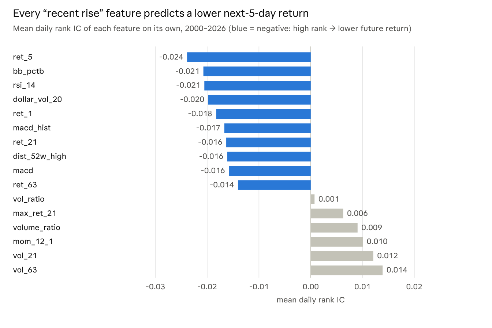
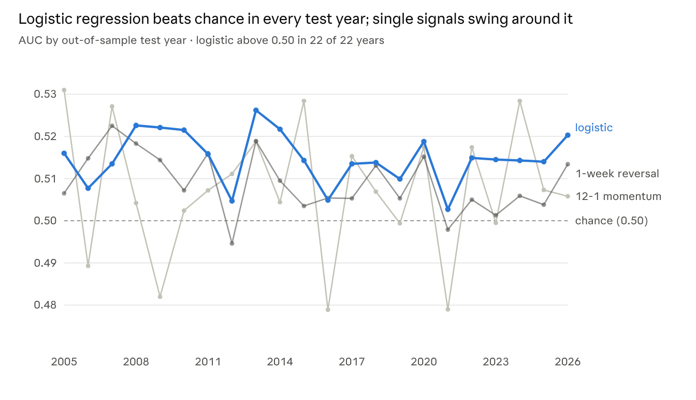
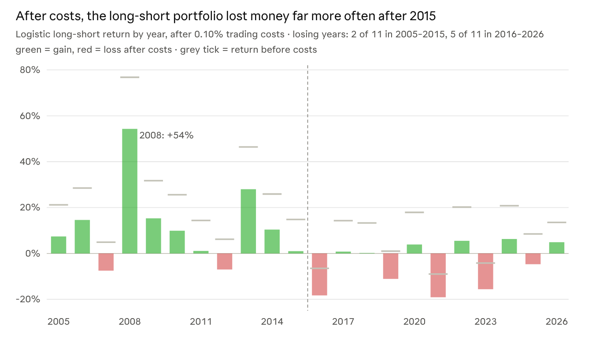
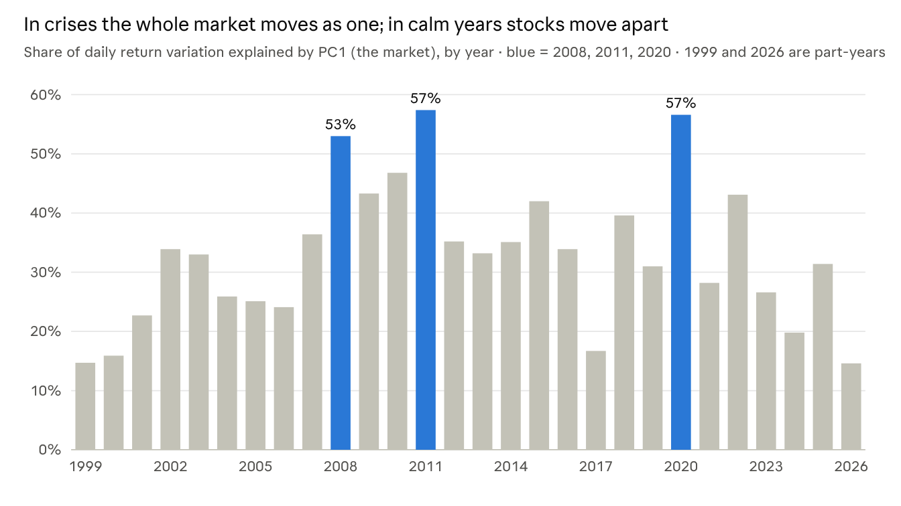

# DS675 Mini Project — Part 1 Results: Analysis of Every Step

23 November 2026 · DS675 Mini Project, Part 1 · PDF version: [part1_results.pdf](part1_results.pdf)

## Summary

The models have a small but real skill at picking which S&P 500 stocks will beat the median stock over the next 5 trading days: the best model (an ensemble of logistic regression and LightGBM) scores AUC 0.516 and a positive rank correlation with returns in all 22 test years (2005–2026). That skill does not yet survive trading costs: a weekly long-short portfolio earns 16.6–18.6% a year before costs but only 2.6–4.5% after them.

**The question.** For each stock on each trading day, will its return over the next 5 trading days be above the median stock's return over the same 5 days? Label 1 = yes, 0 = no. About half the stocks are 1 every day, so guessing scores 50%.

**What the notebook does,** in order (one Kaggle run, 73 cells, about 10 minutes):

1.  Loads and cleans the Kaggle file `master_stock_data.csv` (233 tickers, 2.2 million rows).

2.  Builds the label and 16 features from past prices only.

3.  Tests 5 baselines in 22 walk-forward folds: each test year is predicted by a model trained only on earlier years.

4.  Saves every out-of-sample prediction and lets you look up any stock and period (shown for AAPL).

5.  Simulates a weekly long-short portfolio with 0.10% trading costs.

6.  Runs PCA on the features and on daily stock returns.

7.  Trains LightGBM on the same folds and averages it with logistic regression (the ensemble).

**Headline results**

- **Skill is small and consistent.** Logistic regression: AUC 0.515, IC 0.030, positive in 22/22 years. LightGBM: AUC 0.516, IC 0.031. Ensemble: AUC 0.516, IC 0.033 (best).

- **The main effect is short-term reversal.** Stocks that rose most over the last week tend to lag the next week.

- **LightGBM barely beats logistic on accuracy** (13 of 22 years) **but gives a steadier portfolio:** Sharpe 1.10 vs 0.89 before costs, worst drawdown −23% vs −43%.

- **Trading costs take most of the profit.** The portfolio replaces about 63% of its holdings each week, which costs about 13–14 percentage points a year.

- **The edge has faded since about 2015,** and after costs it was negative on average over 2016–2025.

- **The data is survivorship-biased** (only today's S&P 500 members). The equal-weight average stock returned 16.9% a year, far above the real index, and the models lean heavily toward small stocks partly because of this bias.

## 1. Data loading and cleaning

The data was already clean for the period we use: cleaning removed one ticker (CICC) and 4 rows, and flagged only 2 extreme moves.

**What the code does.** It reads `master_stock_data.csv`, removes CICC, and keeps data from late 1998 on (2000 onward is analysed; the extra year lets 12-month features be computed from January 2000). It drops duplicate rows, treats zero or negative prices as missing, and removes single-day bad prices that jump more than 2x and fully reverse the next day. It lists, but does not drop, any stock with a one-day move above 100%, so a person can judge it.

| Step                                   | Result                       |
|----------------------------------------|------------------------------|
| Raw file                               | 2,219,678 rows, 233 tickers  |
| Tickers removed                        | CICC                         |
| Duplicate rows                         | 0                            |
| Zero or negative prices (from 1998 on) | 0                            |
| Rows with no Adj Close                 | 4 dropped                    |
| Single-day bad prices                  | 0                            |
| After cleaning                         | 1,461,861 rows, 232 tickers  |
| One-day moves above 100%               | 2: HIG and WMB, one day each |

**What it means.**

- **The zero prices our Milestone 2 report found are all in the pre-1998 data,** which this analysis does not use.

- **HIG and WMB look like real events, not errors:** Hartford's rebound in the 2008–09 financial crisis and Williams' near-bankruptcy swing in 2002 are the likely causes. Their dates are in `clean_report["flagged_extreme_moves"]` if you want to confirm. Both stay in.

- **The labelled panel has 231 tickers, one fewer than after cleaning.** One ticker has too little data from 2000 on to get any 5-day labels. It does not affect the results.

**The panel** (one row per stock per trading day with a label) has 1,413,301 rows from 3 January 2000 to 21 August 2026. Labels stop 5 trading days before the data ends (31 August 2026), because each label needs the next 5 days. The number of stocks per day grows from 175 in 2000 to 231 today (median 217), because companies that joined the market later only appear from their listing date.

## 2. Label and features

The label is balanced (49.88% of stock-days are 1), and the strongest single feature is last week's return, which predicts the next week in the opposite direction.

**The label.** For stock *i* on day *t*, y = 1 if its 5-day forward return (Adj Close at t+5 ÷ Adj Close at t − 1) is strictly greater than the median of all stocks' 5-day returns that day. Adj Close is used because it adjusts for splits and dividends. The label measures performance **relative to other stocks**, not up or down: a stock that falls 8% while the median stock falls 12% is labelled 1. The balance is just under 0.5 because the stock exactly at the median gets 0.

**The features.** 16 features are computed from prices up to day *t* only, then each is converted to a rank among all stocks that day (0 = lowest, 1 = highest). Ranking makes a \$5 stock and a \$500 stock comparable and removes the market's overall movement.

| Group                | Features                                                                                             |
|----------------------|------------------------------------------------------------------------------------------------------|
| Recent returns       | `ret_1`, `ret_5`, `ret_21`, `ret_63` (1, 5, 21, 63 days)                                                     |
| Long-term momentum   | `mom_12_1` (12-month return skipping the last month), `dist_52w_high` (distance from the 52-week high)   |
| Volatility           | `vol_21`, `vol_63`, `vol_ratio` (21-day ÷ 63-day), `max_ret_21` (largest daily return in a month)            |
| Volume and size      | `volume_ratio` (today's volume ÷ 20-day average), `dollar_vol_20` (average traded dollars, a size proxy) |
| Technical indicators | `rsi_14`, macd, `macd_hist`, `bb_pctb` (Bollinger %B)                                                      |

Every feature is present on at least 98.9% of stock-days; `mom_12_1` and `dist_52w_high` have the most gaps because they need a year of history.

**Each feature on its own** (the rank IC, explained in the Glossary):

Notebook cell 18 · full sample 2000–2026 · descriptive only

- **The 10 features that measure a recent rise all have negative IC.** This is **short-term reversal:** stocks that rose most lately tend to lag next week. `ret_5` is the strongest (−0.024).

- **Volatility and 12-month momentum are positive:** more volatile stocks and long-term winners did slightly better.

- **`dollar_vol_20` is negative:** smaller stocks did better than larger ones. This and the volatility effect are probably inflated by **survivorship bias**: a small, volatile company from 2000 that is still in today's S&P 500 must have grown a lot to get there.

- This table uses all years at once, so it describes the data; it is not a test result. The tests are in the next section.

## 3. Walk-forward evaluation and baselines

Logistic regression is the best of the five baselines: AUC 0.515 and a positive IC in all 22 test years, with a t-statistic of 10.6 across years, far beyond luck.

**How the test works.** For each test year Y+2 from 2005 to 2026, the model trains on all years up to Y, uses year Y+1 to pick its settings, then is refit on years up to Y+1 and scores year Y+2, which it has never seen. Every stock uses the same yearly cutoffs, and the last 5 trading days before each new period are dropped ("purged"), so no training label overlaps the period being tested. Training sets grow from 182,000 rows (test 2005) to 1.32 million (test 2026); each test year has 48,000–58,000 rows (2026: 37,000, January–August).

**The five baselines.**

- **random:** a random score; the floor every model must beat.

- **momentum_12_1:** buy last year's winners (12-month return, skipping the latest month).

- **momentum_1m:** buy last month's winners.

- **reversal_1w:** buy last week's losers.

- **logistic:** logistic regression on all 16 features.

| Model         | Accuracy | AUC    | Mean IC | IC t-stat | Years IC \> 0 | Top − bottom 10%, 5 days |
|---------------|----------|--------|---------|-----------|---------------|--------------------------|
| logistic      | 51.06%   | 0.5149 | 0.0300  | 10.6      | 22/22         | +37 bps                  |
| reversal_1w   | 50.66%   | 0.5090 | 0.0199  | 6.9       | 20/22         | +25 bps                  |
| momentum_12_1 | 50.53%   | 0.5073 | 0.0124  | 1.9       | 16/22         | −4 bps                   |
| random        | 49.94%   | 0.4993 | −0.0021 | −2.0      | 7/22          | −5 bps                   |
| momentum_1m   | 49.71%   | 0.4951 | −0.0119 | −3.3      | 4/22          | −11 bps                  |

Notebook cell 22 · 22 test years, 2005–2026 (2026 = January–August)

**What it means.**

- **Logistic regression has real skill.** It beats 0.50 AUC in every year, and its IC is 50% higher than the best single rule (reversal, 0.030 vs 0.020), so combining features helps.

- **Short-term reversal is the core effect.** 1-month momentum is negative because it bets the opposite way.

- **12-month momentum is unreliable.** Its IC is slightly positive, but its top-minus-bottom spread is negative, and it collapsed in 2009, 2016 and 2021 (AUC 0.48), years when the previous year's losers rallied hard.

- **Random behaves as it should** (AUC 0.499). Its t-stat of −2.0 is chance, a reminder that a t-stat near 2 alone is weak evidence.

- **The chosen regularization C flips between 0.001 and 1.0** from year to year, which means the validation year barely tells the settings apart. Harmless here, but worth noting.

**The model's coefficients** (last five folds) are stable from year to year, so it is not fitting noise. The largest are `dollar_vol_20` (about −0.13: favours smaller stocks), macd (about −0.13), `ret_5` (about −0.11), `mom_12_1` (about +0.11) and `ret_1` (about −0.09). Single coefficients should not be over-read: `rsi_14` is positive while macd and recent returns are negative because these features overlap heavily and partly cancel out (Section 6 shows how much).

## 4. Out-of-sample predictions and the stock lookup

The notebook saved 1,183,256 honest predictions (every stock, every trading day, 2005–2026) with an overall hit rate of 51.05%; the AAPL lookup confirms the labels are correct, and the per-stock and per-size checks show that no stock or size group is predicted clearly worse.

**What was saved.** For each test year, the logistic model trained only on earlier years predicts that year. Each row of `oos_predictions.csv.gz` has the date, ticker, the model's probability of beating the median (`prob_beat_median`), its rank among all stocks that day (`rank_pct`, 1 = favourite), the model's call (`predicted_y`), what happened (y, `fwd_ret`) and whether the call was right (correct). The probabilities stay between about 0.45 and 0.57, so the model is never confident; the useful output is the **ranking**.

### 4.1 AAPL, February 2020 – April 2022 (546 trading days)

The model was right on 49.8% of AAPL's days, and every label matched a recomputation from actual prices (`labels match recomputation: True`). The 5-day returns were also checked by hand against Apple's published closing prices and matched to within 0.01 percentage points.

The ten rows the notebook displays:

| Date       | Model's rank | Model said | AAPL 5-day | Median stock 5-day | Actual | Right? |
|------------|--------------|------------|------------|--------------------|--------|--------|
| 2022-04-14 | 0.61         | beat       | −2.12%     | −2.02%             | lag    | no     |
| 2022-04-13 | 0.34         | lag        | −2.34%     | +0.15%             | lag    | yes    |
| 2022-04-12 | 0.41         | lag        | −0.26%     | +2.62%             | lag    | yes    |
| 2022-04-11 | 0.58         | beat       | +1.00%     | +1.32%             | lag    | no     |
| 2022-04-08 | 0.41         | lag        | −2.95%     | −1.11%             | lag    | yes    |
| 2020-02-24 | 0.78         | beat       | +0.21%     | −5.18%             | beat   | yes    |
| 2020-02-21 | 0.68         | beat       | −12.68%    | −11.81%            | lag    | no     |
| 2020-02-20 | 0.62         | beat       | −14.61%    | −11.75%            | lag    | no     |
| 2020-02-19 | 0.17         | lag        | −9.57%     | −8.36%             | lag    | yes    |
| 2020-02-18 | 0.78         | beat       | −9.69%     | −7.14%             | lag    | no     |

- **The label is relative.** On 24 February 2020, AAPL gained only 0.21% but counts as "beat", because the median stock fell 5.2% as the COVID selloff began. On 11 April 2022, AAPL rose 1.0% but counts as "lag", because the median stock rose 1.3%.

- **Many calls are decided by tiny margins.** On 14 April 2022, AAPL lagged by 0.1 points; that counts as fully wrong, like a 3-point miss. This is why IC and the decile spread, which use the size of returns, are more reliable than accuracy.

### 4.2 Confidence groups for AAPL

| Model's view            | Days | Hit rate |
|-------------------------|------|----------|
| strong lag (bottom 20%) | 230  | 50.9%    |
| lag                     | 129  | 54.3%    |
| neutral                 | 83   | 44.6%    |
| beat                    | 68   | 44.1%    |
| strong beat (top 20%)   | 36   | 50.0%    |

The model expected AAPL to underperform on 66% of days (359 of 546); AAPL actually beat the median on 46.7% of them. There is no "more confident = more accurate" pattern, and the groups are too small to judge: because each label covers 5 days, 36 days is only about 7 independent calls.

### 4.3 Best and worst stocks, 2005–2026

| Rank | Worst | Hit rate | Best | Hit rate |
|------|-------|----------|------|----------|
| 1    | AAPL  | 46.5%    | HLT  | 54.7%    |
| 2    | DOW   | 46.9%    | ANET | 54.3%    |
| 3    | HAL   | 47.7%    | FTNT | 54.2%    |
| 4    | HSY   | 47.9%    | EMR  | 54.0%    |
| 5    | LVS   | 48.0%    | CNC  | 53.8%    |
| 6    | DLTR  | 48.3%    | USB  | 53.8%    |
| 7    | CAT   | 48.4%    | TDG  | 53.8%    |
| 8    | TSLA  | 48.4%    | LIN  | 53.7%    |
| 9    | GOOGL | 48.4%    | STZ  | 53.6%    |
| 10   | NEE   | 48.6%    | MPWR | 53.5%    |

- **The spread across stocks is what chance produces.** Hit rates vary by 1.37 points (standard deviation) across the 231 stocks; chance alone gives about 1.52 points, because each stock has only about 1,100 independent 5-day periods.

- **No theme links the worst stocks:** tech (AAPL, GOOGL, TSLA), energy (HAL), food (HSY), casinos (LVS), discount retail (DLTR), machinery (CAT), utilities (NEE), chemicals (DOW).

- **AAPL is last, but that can be luck.** It is about 3 standard deviations below average; with 231 stocks, the chance that at least one lands that low by luck is roughly 25–30%. DOW and HLT have short histories (1,867 and 3,191 days), so their rates are the least reliable.

- **Conclusion:** do not pick stocks by their hit rate. The model's skill is spread thinly across all of them.

### 4.4 Does accuracy depend on company size?

| Size group (by dollar volume) | Hit rate | Actually beat median | Model said "beat" |
|-------------------------------|----------|----------------------|-------------------|
| smallest                      | 51.2%    | 51.1%                | 77.6%             |
| small                         | 51.0%    | 50.2%                | 62.9%             |
| mid                           | 50.8%    | 49.7%                | 48.6%             |
| large                         | 51.0%    | 49.4%                | 35.4%             |
| largest                       | 51.3%    | 49.1%                | 24.7%             |

- **Accuracy is flat across sizes;** the largest stocks have the highest hit rate. The model does not predict big companies worse.

- **But the model has a strong size tilt.** It says "beat" for 78% of the smallest stocks and 25% of the largest, while reality differs by only 2 points (51.1% vs 49.1%). This tilt costs almost nothing in accuracy, because every group beats the median about half the time.

- **The tilt matters for the portfolio.** A long-short portfolio from this model mostly buys small stocks and shorts large ones, so part of its profit is the size effect, which the survivorship bias inflates.

### 4.5 One example day: 26 April 2016

Of the model's top 5 picks (TTWO, PGR, KMB, NFLX, XEL), 4 beat the median. Of its bottom 5 (CVX, WMB, C, DVN, OXY), only 2 lagged. Four of the bottom 5 are energy stocks, which had rallied hard from their February 2016 lows; the reversal signal ranked the whole sector low. The model makes sector bets without being told sectors exist, which supports the peer-group features planned for Step 4. WMB's 5-day return is exactly 0.000000 that day, which may be a stale price worth checking.

## 5. Backtest: does the skill make money?

Before costs, buying the model's top 10% and shorting its bottom 10% each week returned 16.6% a year; after 0.10% trading costs it returned only 2.6% a year, with a worst loss of 55% from a peak.

**The rules.** Every 5th trading day: buy the model's top 10% of stocks in equal amounts, sell short its bottom 10%, hold 5 days, repeat (1,089 weekly periods). Each dollar traded costs 0.10%. Returns use Adj Close, so dividends are included. Two comparisons: **long-only** (buy the top 10% only) and **all stocks** (equal amounts in every stock).

| Strategy                       | Annual return | Volatility | Sharpe | Worst drawdown | Weeks positive |
|--------------------------------|---------------|------------|--------|----------------|----------------|
| Long-short, before costs       | 16.6%         | 19.5%      | 0.89   | −43%           | 58%            |
| Long-short, after costs        | 2.6%          | 19.5%      | 0.23   | −55%           | 52%            |
| Long-only top 10%, after costs | 22.5%         | 25.6%      | 0.92   | −51%           | 60%            |
| All stocks, equal weight       | 16.9%         | 18.3%      | 0.95   | −49%           | 60%            |

Notebook cell 42 · logistic model, weekly rebalancing, 2005–2026 (2026 = January–August)

**What it means.**

- **Costs take most of the edge.** The portfolio replaces 63% of its holdings every week. At 0.10% per dollar traded, that is about 0.25% a week, or 13–14 percentage points a year: almost exactly the gap between 16.6% and 2.6%.

- **The edge has faded.** Before costs, the long-short earned 25.6% a year over 2005–2015 but 7.1% over 2016–2025; after costs, +10.5% vs −5.7% a year.

- **2008 carries a lot of the total.** The portfolio made +54% after costs in 2008 while the average stock lost 29%: reversal works best in panics. Without 2008, the after-costs return over 2005–2025 is about 0%.

- **Long-only looks strong, but mostly from extra risk.** It beats the average stock by 5.6 points a year, but its volatility is much higher (25.6% vs 18.3%) and its Sharpe ratio is about the same (0.92 vs 0.95). The model favours small, volatile stocks, so the extra return is mostly pay for risk.

- **The all-stocks return measures the survivorship bias.** 16.9% a year from 2005 to 2026 is far above what the real S&P 500 returned, because the dataset only contains companies that made it into today's index. Long-only numbers here cannot be trusted; long-short is the fairer test, because both sides carry the same bias.

- **0.10% per trade is conservative** for large US stocks today. Repeating the backtest at 0.02% and 0.05%, and with less frequent trading, would show how sensitive the result is (see Section 8).

## 6. PCA: how many independent signals, and what moves stocks together

The 16 features hold about 8 independent signals (8 components cover 91% of their variation), and a model on those 8 predicts almost as well as one on all 16 (AUC 0.514 vs 0.515). In daily returns, the market explains 22% of movement over the last two years, and the next components are clear sector groups: chips vs. defensives, and energy vs. consumer stocks.

**What PCA is.** Principal Component Analysis rewrites many overlapping variables as a few new, uncorrelated ones ("components"), ordered by how much of the total variation each explains. It answers: how many independent things are really going on, and what are they?

### 6.1 PCA on the 16 features

| Components | Share of feature variation explained |
|------------|--------------------------------------|
| 1          | 31.4%                                |
| 2          | 49.5%                                |
| 3          | 60.3%                                |
| 6          | 80.4%                                |
| 8          | 91.3%                                |
| 10         | 95.4%                                |

What the first components mean, from their loadings:

- **PC1 (31%) = "recent trend":** RSI (0.43), 21-day return, Bollinger %B (0.39 each), MACD (0.37), 5-day return and distance from the 52-week high (0.30 each). These six features largely measure the same thing.

- **PC2 (18%) = "volatility":** 21-day and 63-day volatility and the largest daily return (0.50–0.55).

- **PC3 (11%) = "long-term vs short-term trend":** 63-day return and 12-month momentum (+0.43, +0.44) against MACD histogram and 5-day return (−0.42, −0.32). This is the contrast the model exploits: long-term winners that dipped last week.

- **PC4 and PC5** mix the volatility ratio, 1-day return, momentum and volume.

This overlap explains the confusing logistic coefficients in Section 3: when six features measure one trend, the model splits their weight arbitrarily.

### 6.2 Does a model on fewer components predict as well?

PCA was refit inside each fold on training data only (fitting it on all years would let future data shape the components), then logistic regression was trained on the first *k* components.

| Components (k) | AUC    | Mean IC | Years IC \> 0 | Top − bottom 10%, 5 days |
|----------------|--------|---------|---------------|--------------------------|
| 1              | 0.5070 | 0.0168  | 17/22         | +32 bps                  |
| 2              | 0.5075 | 0.0172  | 17/22         | +35 bps                  |
| 3              | 0.5095 | 0.0200  | 18/22         | +31 bps                  |
| 5              | 0.5113 | 0.0236  | 20/22         | +33 bps                  |
| 8              | 0.5139 | 0.0286  | 21/22         | +35 bps                  |
| 16 (all)       | 0.5151 | 0.0300  | 22/22         | +35 bps                  |

- **8 components keep about 95% of the IC** (0.0286 of 0.0300); the last 8 add little.

- **PCA ranks components by how much they vary, not by how well they predict.** The first component alone (31% of variation) gives only about half the IC. Dimension reduction does not improve this model; it shows the features are redundant.

### 6.3 PCA on daily stock returns (last two years: September 2024 – August 2026, 231 stocks)

- **PC1 = the market: 22.1% of daily movement,** and every stock loads positively on it (they all move with the market). PCs 1–5 explain 43.1%, PCs 1–10 51.5%.

- The next components are sector groups, found from prices alone (the dataset has no sector column):

| Component | One end                                    | Other end                                 | Reading                                                           |
|-----------|--------------------------------------------|-------------------------------------------|-------------------------------------------------------------------|
| PC2       | LRCX, MU, NVDA, AMAT, KLAC, ETN, AVGO, AMD | DUK, SO, CL, KO, EXC, CB, PG, GIS         | semiconductors and AI hardware vs. utilities and consumer staples |
| PC3       | BKNG, SHW, HD, ECL, TDG, EW, ADSK, MCO     | XOM, COP, EOG, OXY, DVN, CVX, FANG, APA   | consumer and quality companies vs. oil and gas                    |
| PC4       | CAT, AMAT, LRCX, TXN, KLAC, PPG, NEE, CARR | NOW, CRM, ADP, ADSK, ACN, ROP, CRWD, DDOG | industrials and chip equipment vs. software                       |

**AAPL's nearest peers** (stocks whose returns load most like Apple's on PCs 2–11, market removed): WBD 0.71, LVS 0.67, MGM 0.62, NKE 0.61, SBUX 0.59, MAR 0.53, BKNG 0.53, HLT 0.53, EXPE 0.50, AMZN 0.50. Over the last two years, Apple traded like a consumer stock, not a chip stock; several of these peers (LVS, MGM, NKE, SBUX) share heavy China and consumer exposure, which may explain the link in a period of trade tensions. This is the kind of grouping the Step 4 peer groups will use.

### 6.4 How strongly does the market move together, year by year?

Notebook cell 58 · correlation-matrix eigenvalues of each calendar year's daily returns, stocks with ≥ 95% of days

The market factor jumps in crises (53% in 2008, 57% in 2011, 57% in 2020) and falls in calm years (17% in 2017, 15% in 2026 so far). When everything falls together, picking stocks matters least, which is exactly when the relative label (beat the median) is most useful: it removes the market's move.

## 7. LightGBM and the ensemble

LightGBM matches logistic regression on accuracy (AUC 0.5156 vs 0.5149, better in only 13 of 22 years) but gives a clearly steadier portfolio: Sharpe 1.10 vs 0.89 before costs and a worst drawdown of −23% vs −43%. Averaging the two models (the ensemble) gives the best IC of all, 0.033.

**What LightGBM is.** It builds many small decision trees, each correcting the previous ones. Unlike logistic regression it can learn non-linear effects and interactions (for example, "reversal only matters for volatile stocks").

**How it was trained.** Same 22 folds. For each test year: train on years ≤ Y and stop adding trees when the AUC on year Y+1 stops improving (early stopping); then refit on years ≤ Y+1 with that many trees and predict year Y+2. Settings are cautious for noisy data: each leaf covers at least 2,000 stock-days, learning rate 0.05, row and feature subsampling, L2 regularization. The whole run took 3 minutes.

**The ensemble** averages each stock's daily rank from the two models.

### 7.1 All models compared

| Model                          | Accuracy | AUC    | Mean IC | IC t-stat | Years IC \> 0 | Top − bottom 10%, 5 days |
|--------------------------------|----------|--------|---------|-----------|---------------|--------------------------|
| ensemble (logistic + LightGBM) | 51.10%   | 0.5159 | 0.0328  | 11.3      | 22/22         | +39 bps                  |
| LightGBM                       | 51.04%   | 0.5156 | 0.0315  | 11.1      | 22/22         | +37 bps                  |
| logistic                       | 51.06%   | 0.5149 | 0.0300  | 10.6      | 22/22         | +37 bps                  |
| reversal_1w                    | 50.66%   | 0.5090 | 0.0199  | 6.9       | 20/22         | +25 bps                  |
| momentum_12_1                  | 50.53%   | 0.5073 | 0.0124  | 1.9       | 16/22         | −4 bps                   |
| random                         | 49.94%   | 0.4993 | −0.0021 | −2.0      | 7/22          | −5 bps                   |
| momentum_1m                    | 49.71%   | 0.4951 | −0.0119 | −3.3      | 4/22          | −11 bps                  |

- **LightGBM's gain over logistic is not reliable.** It wins 13 of 22 years, by +0.001 to +0.010 AUC, and loses the other 9 by up to −0.007. Its biggest wins were 2009 (+0.010) and 2016 (+0.010); its biggest losses 2024 (−0.007) and 2018 (−0.007).

- **The trees stayed small:** early stopping chose only 10–296 trees per year (often under 70). The signal is weak, so LightGBM stops before it finds much non-linear structure. That is the correct behaviour: with weak, mostly linear signals, trees should not beat a linear model by much.

- **The ensemble is the best predictor** on IC, IC t-stat and decile spread, because the two models make partly different mistakes.

### 7.2 Which features LightGBM uses (share of total gain, average over 22 yearly models)

| Feature              | Average share | Range across years |
|----------------------|---------------|--------------------|
| `dollar_vol_20` (size) | 14.0%         | 10.3–22.1%         |
| `mom_12_1`             | 9.9%          | 8.1–12.0%          |
| `ret_5`                | 9.6%          | 3.7–15.7%          |
| `rsi_14`               | 7.6%          | 3.6–19.5%          |
| `ret_63`               | 7.4%          | 5.6–8.9%           |
| macd                 | 7.2%          | 5.2–8.6%           |

The other 10 features each get 2–6%; `bb_pctb` (2.0%) and `ret_21` (3.2%) get the least, because they overlap with RSI and MACD (Section 6). **Size is LightGBM's most-used feature,** so it leans on the same small-versus-large effect as logistic regression, which the survivorship bias inflates. "Gain" shows what the model uses, not what causes returns.

### 7.3 Backtest comparison (same rules: weekly, top/bottom 10%, 0.10% per trade)

| Model    | Before costs: return | Sharpe | Worst drawdown | After costs: return | Sharpe | Worst drawdown | Turnover per week |
|----------|----------------------|--------|----------------|---------------------|--------|----------------|-------------------|
| logistic | 16.6%                | 0.89   | −43%           | 2.6%                | 0.23   | −55%           | 63.5%             |
| LightGBM | 18.6%                | 1.10   | −23%           | 4.5%                | 0.34   | −40%           | 63.1%             |
| ensemble | 18.4%                | 1.02   | −37%           | 4.1%                | 0.31   | −51%           | 63.6%             |

- **LightGBM's portfolio is the best of the three:** 2 points more return before costs, with less volatility (16.9% vs 19.5%) and about half the worst drawdown. Its top and bottom 10% are better chosen even though its overall AUC is about the same.

- **Turnover is the same for all three (about 63% a week),** so costs still take about 14 points a year from each, and none earns more than 4.5% a year after costs.

- **After costs, year by year,** LightGBM did much better than logistic in 2020 (+23.5% vs +3.9%), 2019 (+2.5% vs −11.1%) and 2023 (−4.7% vs −15.6%), and worse in 2013 (+8.4% vs +28.0%). All three lost 19–21% in 2021.

## 8. Conclusions, limitations and next steps

The prediction task works, a simple weekly trading strategy does not survive costs, and the next work should cut turnover and remove the size and sector bets rather than add model complexity.

**Conclusions**

1.  **There is real, consistent skill.** Every model beats chance in all 22 out-of-sample years; the best IC is 0.033. For 5-day stock-vs-stock prediction, that is a respectable result.

2.  **Short-term reversal is the core signal,** helped by 12-month momentum and a (survivorship-inflated) preference for smaller stocks.

3.  **More complex models add little accuracy** (LightGBM +0.0007 AUC) **but improve the portfolio** (Sharpe 1.10 vs 0.89 before costs).

4.  **Trading costs erase most of the profit,** and after costs the strategy lost money on average after 2015.

5.  **The data pipeline is verified:** no lookahead (tested), labels recomputed and matched, AAPL returns matched published prices.

**Limitations**

- **Survivorship bias.** Only today's S&P 500 members are included (233 of 250 tickers requested). Small, volatile stocks look better than they were, and absolute returns are inflated. Long-short results are the fairer test.

- **Costs are a single assumption** (0.10% per dollar traded); no market impact, borrowing costs for short positions, or bid-ask modelling.

- **2026 is a partial year** (January–August).

- **Per-stock results are mostly noise;** do not read much into one stock's hit rate.

**Next steps**

- [ ] Trade less: rebalance every 2–4 weeks, or keep a stock until it leaves the top 30% instead of the top 10%.

- [ ] Smooth the signal: average each stock's score over the last 5 days before ranking.

- [ ] Show cost sensitivity: repeat the backtest at 0.02% and 0.05% per trade.

- [ ] Size-neutral backtest: pick the top and bottom 10% within each size group, to separate skill from the size effect.

- [ ] Retrain without `dollar_vol_20` and check whether AUC holds.

- [ ] Step 4 peer groups: cluster stocks on their return PCA loadings (Section 6.3) and add features that compare each stock only with its peers.

- [ ] Step 7b: the LSTM on the same folds, judged against the ensemble's IC 0.033 and LightGBM's after-costs 4.5%.

## 9. Glossary

| Term                         | Meaning                                                                                                            | How to read it here                                                                |
|------------------------------|--------------------------------------------------------------------------------------------------------------------|------------------------------------------------------------------------------------|
| AUC                          | Probability that the model scores a stock that beat the median above one that did not                              | 0.50 = chance; 0.515 = right 51.5% of the time when comparing a winner and a loser |
| IC (information coefficient) | Each day, the rank correlation between the model's scores and the stocks' actual 5-day returns, averaged over days | 0 = no relation; 0.02–0.05, consistently positive, is a useful signal in finance   |
| t-stat (across years)        | How consistently the yearly IC is above zero                                                                       | above about 2 is unlikely to be luck; 10.6 is very strong                          |
| Accuracy / hit rate          | Share of correct beat/lag calls (the top half of each day counts as "beat")                                        | 50% = chance                                                                       |
| bps (basis points)           | Hundredths of a percent: 100 bps = 1%                                                                              | +37 bps = the top 10% beat the bottom 10% by 0.37% per 5 days                      |
| Long-short                   | Buy the top 10%, sell short the bottom 10% in equal amounts                                                        | removes the market's move; earns the spread between them                           |
| Turnover                     | Share of the portfolio replaced each week                                                                          | 63% = most holdings change weekly, which drives costs                              |
| Sharpe ratio                 | Annual return divided by annual volatility                                                                         | higher = more return per unit of risk; above 1 is good                             |
| Max drawdown                 | Largest fall from a peak to a later low                                                                            | −55% = at worst, the portfolio lost 55% of its peak value                          |
| Walk-forward                 | Train on the past, test on the next unseen year, roll forward                                                      | the honest way to test a model on time series                                      |
| Survivorship bias            | Using only companies that survived to today                                                                        | inflates past returns, especially of small, volatile stocks                        |
| PCA                          | Rewrites overlapping variables as uncorrelated components ordered by variance                                      | shows how many independent signals or market drivers exist                         |

**Rerunning the lookup for another stock:** in the cell under "Look up one stock", change `TICKER, FROM, TO = "AAPL", "2020-02-15", "2022-04-15"` to another ticker and dates (predictions exist from 2005-01-03 to 2026-08-21), then run that cell plus the label-check and confidence-group cells below it. The repository [README](../README.md#3-look-up-a-different-stock-change-the-ticker) has the full instructions.
